#  cirfig_gen

[](LICENSE)


cirfig_gen makes the figures of an analog circuit deck with a coding agent and keeps the deck
tidy. It draws circuit schematics as single SVG files from a fixed palette of symbols, draws
plots in one matplotlib style, and holds the rules behind both: line widths, label sizes, how
a picture goes onto a slide, and what a slide may show at all. You describe a circuit or a
plot in plain words. Claude Code or Codex lays it out, checks it against the rules and hands
you one file to drop into PowerPoint, Keynote or any other slide tool.

<table>
  <tr>
    <td align="center" valign="middle">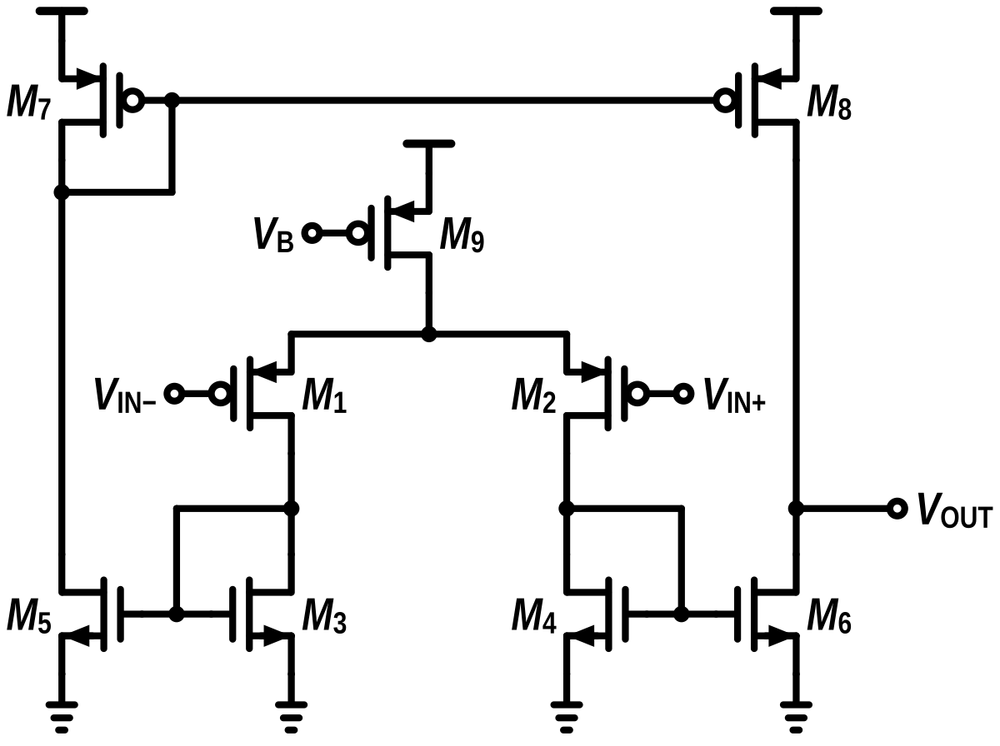</td>
    <td align="center" valign="middle">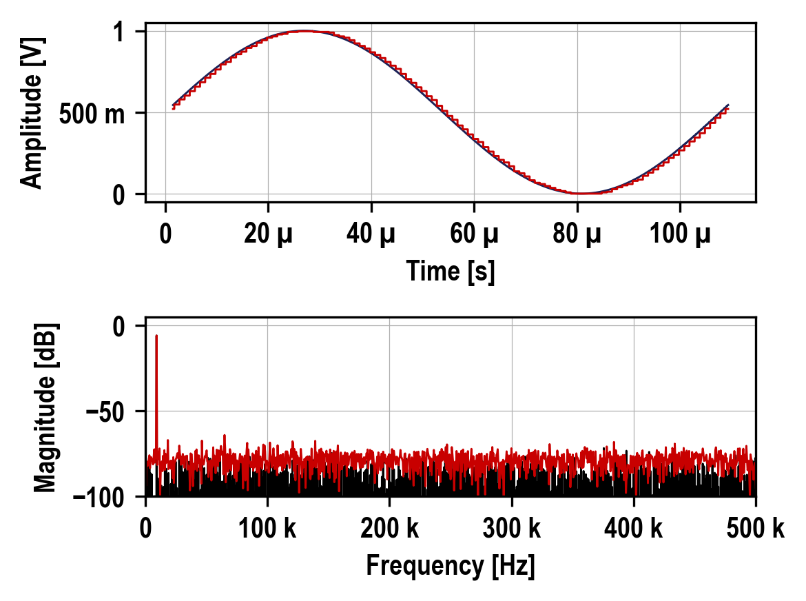</td>
  </tr>
  <tr>
    <td align="center"><sub>A schematic: one SVG of 436 × 323 pt, inserted at 100 %</sub></td>
    <td align="center"><sub>A plot: one PNG 4 in wide, pasted at 16 cm</sub></td>
  </tr>
</table>

## Contents

- [Three things in one repository](#three-things-in-one-repository)
- [Why one file per figure](#why-one-file-per-figure)
- [Quick start](#quick-start)
- [Schematics](#schematics)
- [Plots](#plots)
- [Rules for the deck](#rules-for-the-deck)
- [Working with the agent](#working-with-the-agent)
- [Repository map](#repository-map)
- [Fonts](#fonts)
- [Requirements](#requirements)
- [License](#license)

## Three things in one repository

| | What it holds | Where |
|---|---|---|
| **Schematics** | 55 symbols at fixed sizes, 24 drawing rules, a renderer that turns a JSON layout into one SVG and checks it, and five reference figures | `palette/`, `rules.md`, `tools/render.py`, `references/` |
| **Plots** | Nine reference scripts in eight folders, all in one matplotlib style, which the agent copies for any new plot | `references/plots/` |
| **Rules for the deck** | What a slide may show, how every picture goes onto it at a fixed size, and how the agent works with you | `AGENTS.md`, `CLAUDE.md` |

The rules are plain Markdown. They work in any coding agent, and they work with no agent at
all, as a checklist for a deck you build by hand.

## Why one file per figure

A schematic built from separate shapes and lines in PowerPoint falls apart in the PDF export.
Every object shifts by its own small amount, up to about 0.4 pt, and the wires no longer meet
the symbol leads. A single SVG per circuit keeps every line exactly aligned, on screen and in
the PDF. The labels inside it are glyph outlines, so the figure looks the same on every
computer.

The same idea sets the sizes. A symbol is never resized, so every main line in every figure is
3.00 pt. A figure is never resized on the slide, so its lines stay 3.00 pt and its labels
20 pt across the whole deck. A plot is normally 4 in wide and always pasted at 4 cm per inch,
so its 0.7 pt lines and 10 pt text appear the same on every slide. Every figure in a deck ends up with the
same line widths and font sizes without anyone adjusting pictures by eye.

## Quick start

1. Clone the repository and open the folder in Claude Code or Codex:

   ```
   git clone https://github.com/KwantaeKim/cirfig_gen.git
   cd cirfig_gen
   claude        # or: codex
   ```

   On first use the agent builds `tools/glyphs.json` from a font on your computer and tells
   you which font it chose (see [Fonts](#fonts)).

2. Ask for a circuit or a plot, for example:

   > Draw a PMOS-input current-mirror OTA.

   > Draw an NMOS current mirror with a reference current source and an output terminal.

   > Plot the phase margin of a second-order loop against its damping factor.

   The agent picks up its instructions from `AGENTS.md` by itself. You do not need to open any
   other file. For a circuit it writes the netlist in its reply first, then saves
   `output/<name>.svg` with a PNG preview and the editable JSON layout, and reports the exact
   size in pt, the topology, and every place where a rule could not be met. For a plot it saves
   a PNG and keeps the script in `output/build/`.

3. Put the file on the slide.
   - A schematic: insert the SVG (drag it in, or **Insert → Pictures → Picture from File**).
     Check that its size matches the reported width × height, then only move it.
     **Never resize it.** Resizing scales every line width.
   - A plot: paste the PNG and set its width to 16 cm with the aspect ratio locked.

4. To change something, ask the agent ("move the M5 label", "add a cascode", "make it
   narrower"). It updates the figure and tells you whether the size changed:
   - Same size: right-click the picture → **Change Picture**. It keeps its place.
   - Size changed: delete the old picture and insert the new one. Change Picture would
     stretch it to the old size and change the line widths.

If a figure is too big for your slide, ask for a tighter layout instead of scaling it down.

## Schematics

### Reference figures

The figures in `references/` are the standard for every new one. Before a new layout the agent
opens the closest reference and reuses its spacings: device pitch, wire length between stacked
devices, label gaps. Figures that go into one deck therefore share the same spacings.

<table>
  <tr>
    <td align="center" valign="bottom">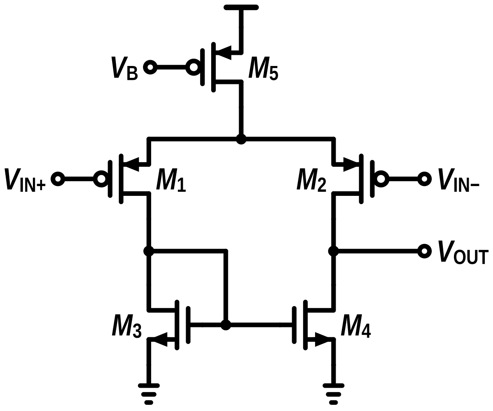</td>
    <td align="center" valign="bottom">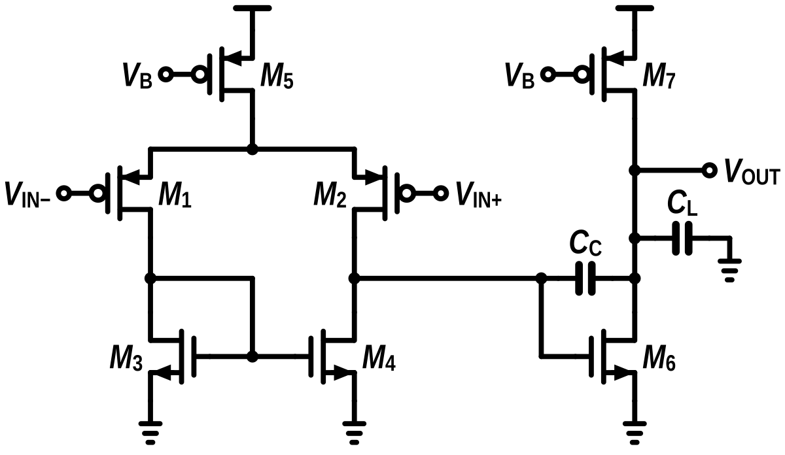</td>
  </tr>
  <tr>
    <td align="center"><sub><code>OTA/OTA1P</code>, PMOS-input five-transistor OTA, 321 × 267 pt</sub></td>
    <td align="center"><sub><code>OTA/OTA3P</code>, PMOS-input two-stage OTA with Miller compensation, 463 × 265 pt</sub></td>
  </tr>
  <tr>
    <td align="center" valign="bottom">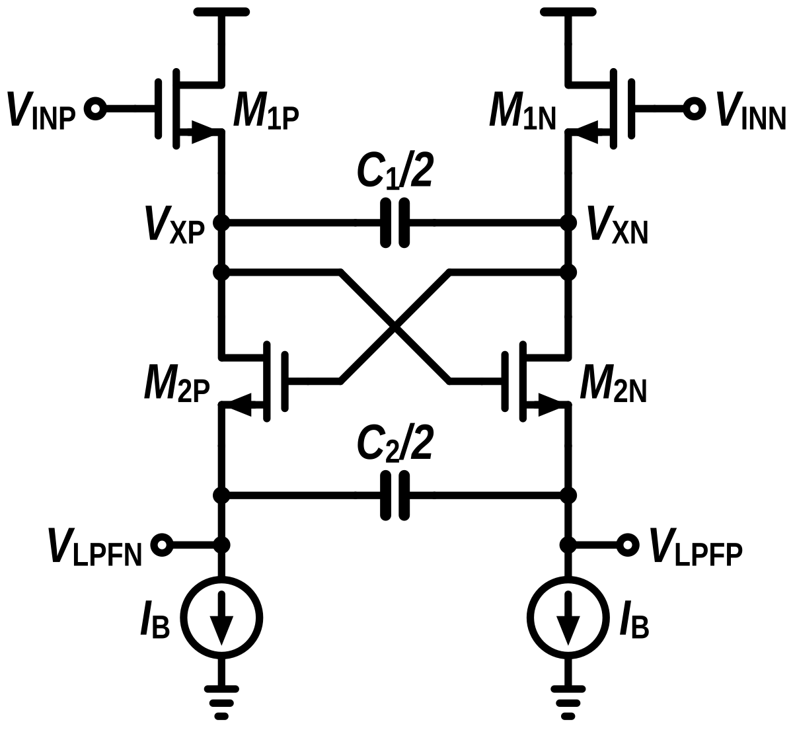</td>
    <td align="center" valign="bottom">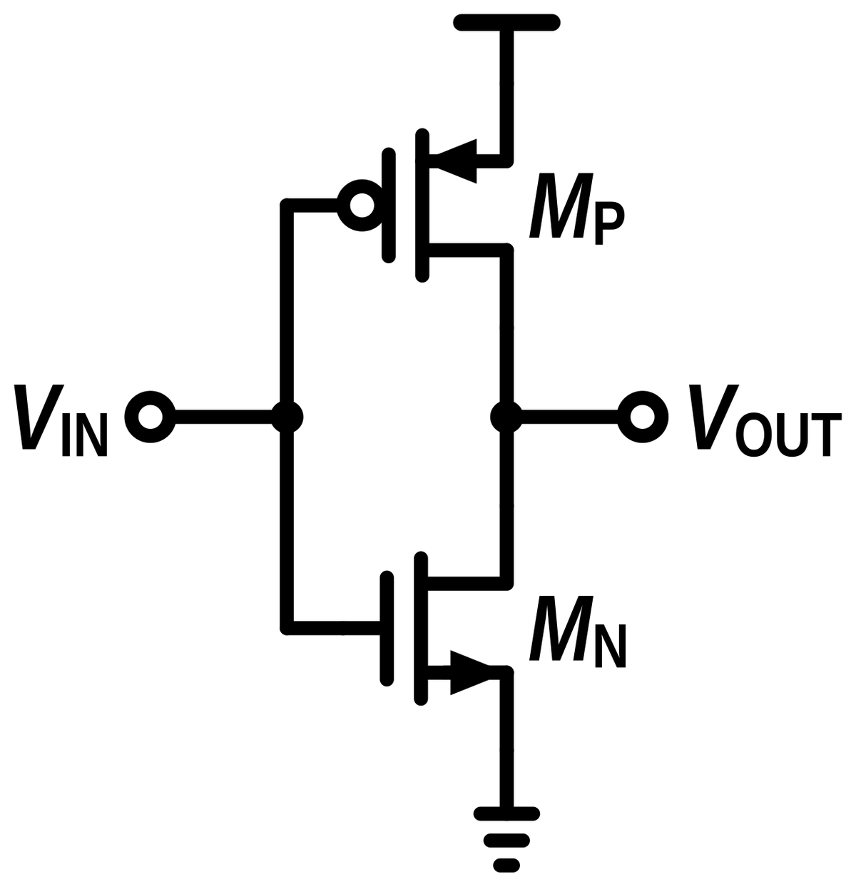</td>
  </tr>
  <tr>
    <td align="center"><sub><code>LPF/LPF1N</code>, source-follower low-pass filter with a cross-coupled pair, 321 × 294 pt</sub></td>
    <td align="center"><sub><code>Logic/INV1</code>, CMOS inverter, 182 × 189 pt</sub></td>
  </tr>
</table>

Each reference is three files: the JSON layout, the SVG the renderer wrote from it, and a PNG
preview. The pictures above are shown at the same relative scale as on a slide.

### The drawing rules

`rules.md` has the 24 rules in full. The numbers that shape every figure:

| Element | Rule |
|---|---|
| Wire | 3.00 pt solid black, horizontal or vertical. The only diagonals are the X of a cross-coupled pair, which crosses once and gets no dot |
| Symbol | Only from `palette/`, at its palette size, so its main line is also 3.00 pt. A horizontal flip is allowed. A rotation never is, because it swaps drain and source |
| Wire end | Lands exactly on a pin or on another wire. Its cap comes from what it touches: butt on a straight edge, round everywhere else |
| Junction dot | A 7.09 pt filled circle where three or more wires meet, nowhere else. Never on a bend or on a crossing |
| Terminal | Every input, output and bias terminal ends in a Voltage Node ring |
| VDD | Sits directly on the pin it supplies, with no wire between |
| GND | Hangs on a 13.5 pt vertical wire below its pin |
| Supplies | One VDD or GND symbol per pin. Never a shared rail with a junction dot |
| Tail | The common node of a differential pair is one horizontal wire that ends on both source pins |
| Label | 20 pt Bold Italic, black. Subscripts are 13.3 pt upright Bold with their baseline 1.5 pt lower. A real minus sign (−), never a hyphen |
| Label placement | A device label sits beside the drain/source lead on the side away from the gate. A signal label sits on the outer side of its terminal. 3 pt gap, and never an overlap |
| Margin | 3 pt around everything, including line caps and glyphs |
| Crossings | Avoided. An unavoidable one gets no dot |

### The palette

55 symbols, each used at exactly the size in `palette/palette.csv`, so that every main line
is 3.00 pt. The agent derives every pin from the symbol's SVG and the pin offsets listed in
`AGENTS.md`, and the wires follow from the pins. The sheet below shows every symbol at its
palette size under the name that goes into a layout as its `type`. It is itself a figure from
the renderer, built by `docs/palette.py`.

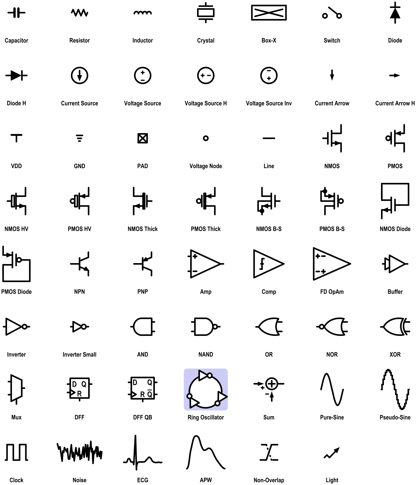


### How a figure is made

1. **Netlist first.** The agent writes the netlist in its reply: every device with its gate,
   drain and source nets, every terminal, and the input polarity. The wires are built from it.
2. **Layout as a script.** A short Python script in `output/build/<name>.py` places each
   symbol by the point its lead must reach, derives every pin from the offsets in `AGENTS.md`,
   lets the wires follow from the pins, and writes `output/<name>.json`:

   ```json
   {
     "name": "PMOS-input Current-Mirror OTA",
     "symbols": [{"id": "M1", "type": "PMOS", "left": 122.8699, "top": 185.9232, "flip": false}],
     "wires":   [[160.0, 170.1733, 160.0, 188.1733]],
     "dots":    [[220.0, 170.1733]],
     "labels":  [{"runs": [["M", "main"], ["1", "sub"]], "x": 164.5, "y": 214.1319, "align": "left"}]
   }
   ```

3. **Render and check.** `tools/render.py` turns the JSON into the SVG, adds the 3 pt margin,
   picks every wire cap, and reports:

   ```
   $ python3 tools/render.py output/OTA2P.json
   Wrote output/OTA2P.svg
   Size: 435.97 x 322.89 pt (insert at 100%, never resize)
   23 wires, 20 symbols, 8 dots, 13 labels
   Checks: all wire ends on pins or wires
   ```

   It lists every wire end that misses a pin or wire, every diagonal that is not half of a
   cross-coupling X, and every GND or VDD whose lead arrives from the wrong side. In a turned
   figure it also lists every label closer than 3 pt to a wire, symbol, dot or other label.
4. **Preview and read back.** The agent renders a PNG, crops into any dense area, and reads the
   picture back against the netlist device by device. It counts the dots, looks for crossings,
   and checks the label boxes its script printed. Every SVG comes out of the renderer. Nothing
   is hand-written or patched.
5. **Report.** The SVG path, its exact size in pt, the topology, every wire crossing and every
   place where a rule could not be met. A figure wider than about 900 pt or taller than about
   450 pt will not fit a 16:9 slide (960 × 540 pt) at 100 %, and the agent offers a tighter
   layout instead.

### Turning a figure

A figure that must lie sideways is turned in its JSON, never in PowerPoint. The optional
`"rotate": 90` (or 180, 270) turns the finished figure clockwise. Every coordinate stays in the
unturned frame. Wires, dots, transistors and the other device bodies turn with the figure.
GND, VDD, the signs of a voltage source and every label stay upright, and the renderer runs
every check on the turned geometry. The SVG is the turned figure and goes onto the slide at
100 % like any other.

### Changing a figure

Once you approve a figure, its coordinates are frozen. A later request moves only the part it
names, and everything else keeps its exact position, so that Change Picture keeps working. If
you edit `output/<name>.json` by hand, your edit is the master: the agent carries it into the
layout script before running the script again.

## Plots

Every plot comes from the same matplotlib style, defined by `apply_style` and `style_axis` in
each reference script. The agent opens the reference closest to the plot it needs, reuses those
two functions, computes the curves from the physics or from your data, and keeps the look
exactly.

<table>
  <tr>
    <td align="center" valign="bottom"></td>
    <td align="center" valign="bottom">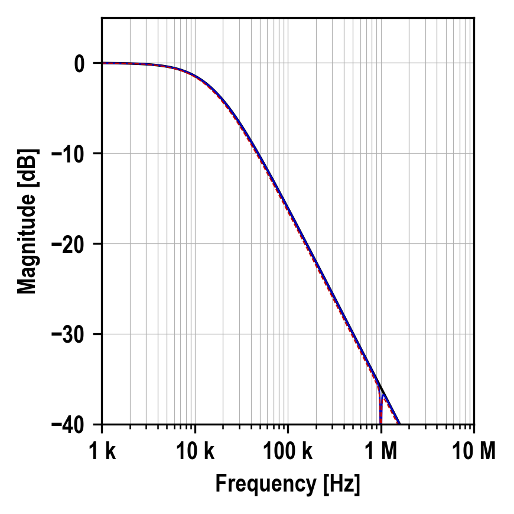</td>
    <td align="center" valign="bottom">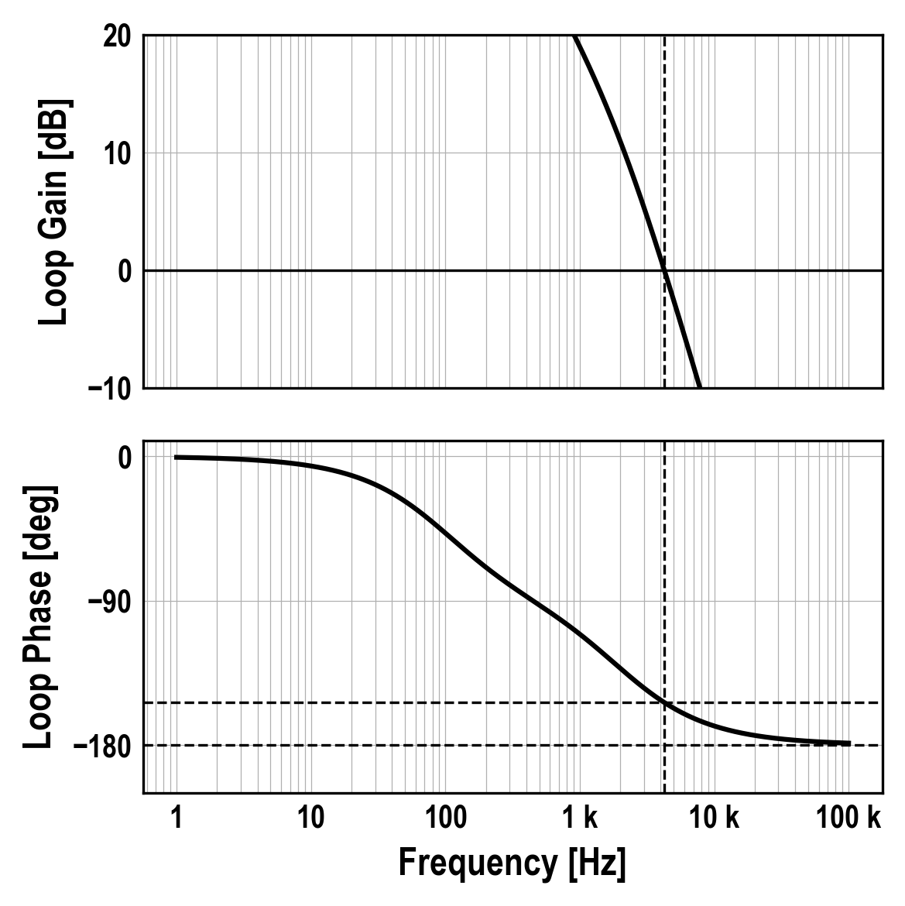</td>
    <td align="center" valign="bottom">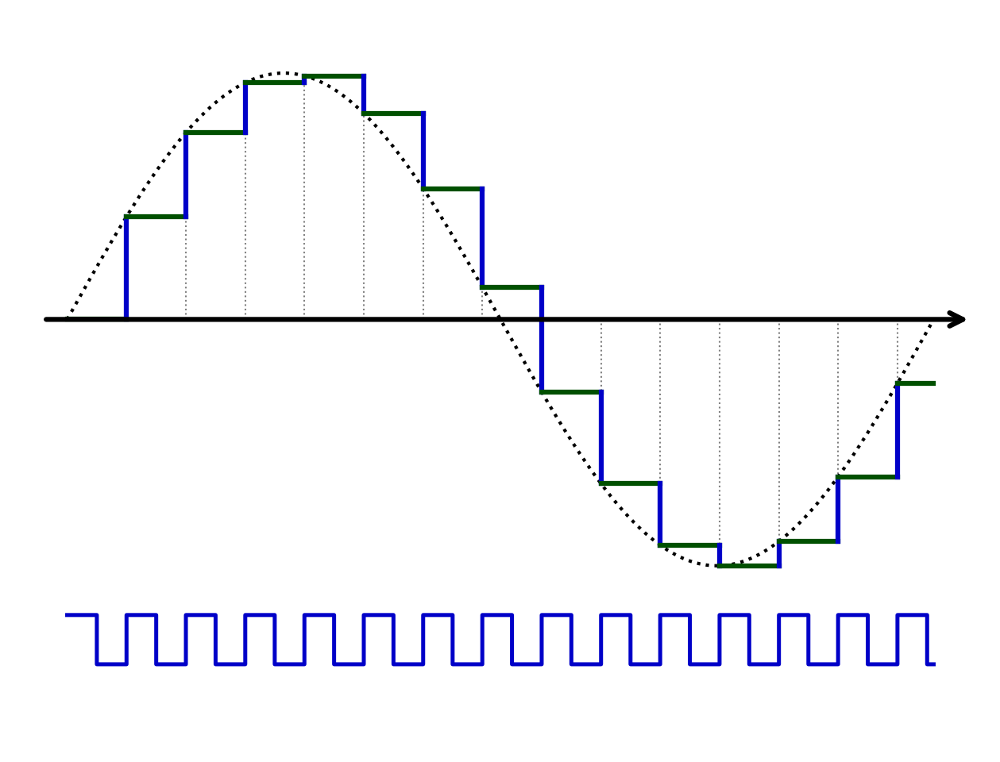</td>
  </tr>
  <tr>
    <td align="center"><sub><code>SQNR.py</code><br>4 × 3 in, 16 cm</sub></td>
    <td align="center"><sub><code>sc_filt.py</code><br>3 × 3 in, 12 cm</sub></td>
    <td align="center"><sub><code>stability.py --fig bode</code><br>4 × 4 in, 16 cm</sub></td>
    <td align="center"><sub><code>sample_hold.py --fig sh</code><br>4 × 3 in, 16 cm</sub></td>
  </tr>
  <tr>
    <td align="center" valign="bottom">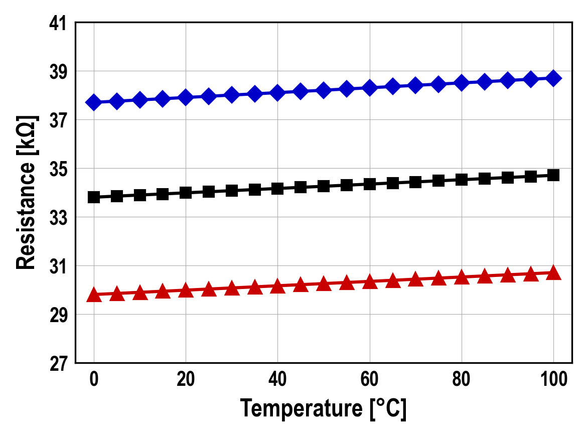</td>
    <td align="center" valign="bottom">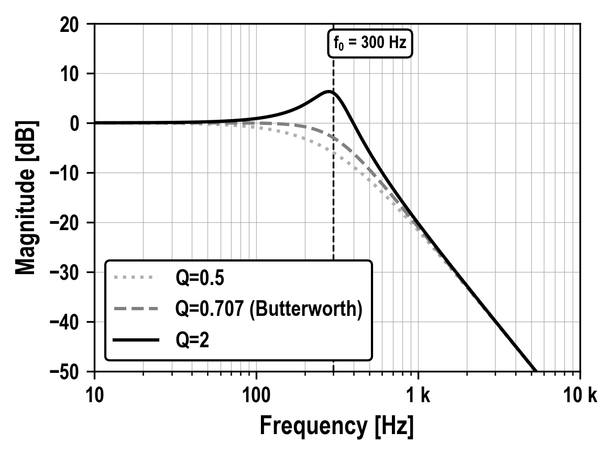</td>
    <td align="center" valign="bottom">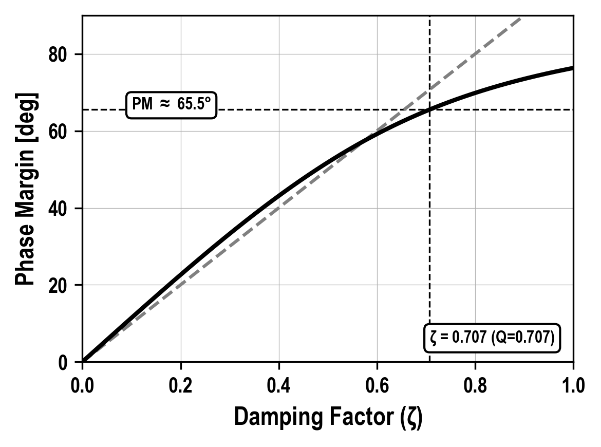</td>
    <td align="center" valign="bottom">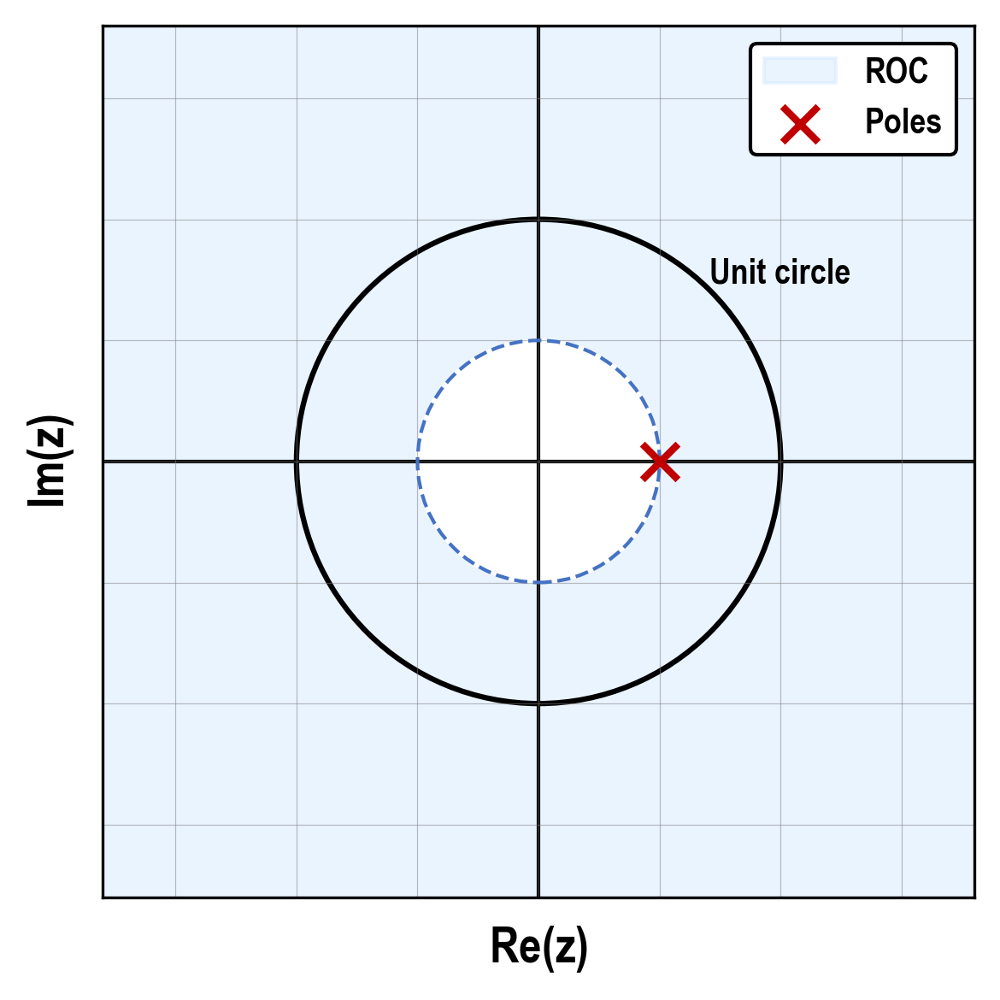</td>
  </tr>
  <tr>
    <td align="center"><sub><code>resistor_corners.py</code><br>4 × 3 in, 16 cm</sub></td>
    <td align="center"><sub><code>biquad.py --fig q</code><br>4 × 3 in, 16 cm</sub></td>
    <td align="center"><sub><code>phase_margin.py</code><br>4 × 3 in, 16 cm</sub></td>
    <td align="center"><sub><code>pole_zero.py --plane z</code><br>4 × 4 in, 16 cm</sub></td>
  </tr>
</table>

The shared look:

- Arial Narrow bold axis labels, with engineering tick labels (µ, m, k, M) through
  `EngFormatter`.
- Navy, red `#C80000` and black lines, 0.7 pt for measured or simulated data and 1 to 1.5 pt
  for a theory curve.
- A 0.3 pt grid on major and minor ticks.
- A 4 in wide figure saved as PNG at 300 dpi with `bbox_inches="tight"`.
- No title and no caption sentence. The slide carries the title. No legend when the slide can
  carry the labels.
- The key point marked with a dot, a dotted guide line and a short label in a rounded white
  box, with any projection extended far enough that the key point is visible.

The references show the style, not a catalogue of allowed plots. An SRAM read margin against
supply, a PLL phase-noise spectrum, an LDO load transient or a mirror's output current against
output voltage gets the same treatment from the reference whose kind of plot is closest:

| Reference | Kind of plot | The reference for |
|---|---|---|
| `SQNR/SQNR.py` | Two panels, a transient waveform over its FFT spectrum | Any waveform or spectrum |
| `SC_filter/sc_filt.py`, `sc_filt_rc.py` | Log frequency axis, theory against simulation | Any transfer function or Bode magnitude plot |
| `resistor_corners/resistor_corners.py` | Three corner lines with a marker on every point | Any corner or sweep plot with few points |
| `sample_hold/sample_hold.py` | Waveform drawings with the axes off, and the zero-order-hold roll-off with guides | Any waveform sketch without axes, and annotated theory curves |
| `pole_zero/pole_zero.py` | s-plane and z-plane with the region of convergence shaded | Pole-zero maps |
| `biquad/biquad.py` | Second-order and sixth-order filter responses with a legend | Any theory curve comparison with a legend |
| `phase_margin/phase_margin.py` | An exact curve against a rule of thumb, guides at the key point | A curve with its key point marked |
| `stability/stability.py` | Loop gain over loop phase, or closed-loop magnitude over step response | Any Bode pair |

Every script runs on its own:

```
python3 references/plots/stability/stability.py --fig bode --out fig.png
python3 references/plots/pole_zero/pole_zero.py --plane z --poles=0.5+0.5j,0.5-0.5j --out fig.png
```

On the slide, a plot is pasted at 4 cm of slide width per inch of figure width, with the
aspect ratio locked:

| Figure width | Paste at | What the slide shows |
|---|---|---|
| 4 in (the default) | 16 cm | 0.7 pt lines at about 1.1 pt, 10 pt text at about 16 pt |
| 3 in | 12 cm | The same |
| 6 in | 24 cm | The same |

Resizing a plot is fine only as long as the line widths and font sizes that appear on the
slide stay at those values.

## Rules for the deck

The slide rules live in `AGENTS.md` and `CLAUDE.md`. The agent applies them to every figure it
makes, and they are just as useful for a slide you build by hand.

**Every picture**

- One figure is one file. It goes onto the slide at 100 %, never scaled, never rotated and
  never cropped in PowerPoint. A figure that must lie sideways gets its turn from the JSON.
- A schematic keeps its 3 pt lines and 20 pt labels on every slide because it is never
  resized. A plot keeps its 0.7 pt lines and 10 pt text because it is always pasted at 4 cm
  per inch.
- Supply symbols, labels and arrows are part of the figure. Nothing is added as a separate
  picture on the slide.
- Figures in one deck share the same spacings, taken from `references/`.
- A figure that would not fit at 100 % gets a tighter layout: one representative cell, fewer
  stages, folded routing. Never a smaller scale.
- No title on a figure or a plot. The slide carries the title.

**What a slide shows**

- Draw the mechanism, not the verdict. Show what actually happens in the circuit or system:
  the real waveform, the current path, the node that moves. A badge or a word that only states
  the outcome is too simplified.
- Labeled boxes are not a visualization. No icon plus number plus caption tiles, no cards
  holding facts, no process flows drawn as chains of rounded text blocks. When a spec asks for
  them, the spec is turned into a drawing.
- Hide all text, and the slide must still tell the story. Text on a picture is a short label
  of one to three words.
- No explanatory phrases on a picture. If a label needs a verb, a visual replaces it and the
  sentence goes into the speaker notes.
- On a plot, mark the key point with a dot, a dotted guide line and a short label.
- Physics must be right. Simplify, but never draw something false. When the physics of a
  picture is unclear, it is stated in one sentence before drawing.

**Text**

- Plain statements of what a thing does. No slogans, taglines or catchy headlines, not on a
  figure, not in a note, not in a commit message.
- No dash and no semicolon to join phrases. A period, a comma or a conjunction instead.
- A real minus sign (−) in every label, never a hyphen.

## Working with the agent

- **Netlist first.** Before placing anything, the agent writes the netlist in its reply, and
  after rendering it reads the preview back against it. Nothing else catches a wrong topology.
- **Ask once.** When a request leaves a real choice, such as the input device type, the number
  of stages, or single-ended against differential, the agent offers two or three options with
  a recommended default and proceeds. It does not ask about what the rules already decide.
- **One change per round**, with a preview.
- **Approved figures are frozen.** A later request moves only the part it names, so that
  Change Picture keeps every other figure in place.
- **A rejected direction is reverted fully.** The next try is a different idea, not a variation
  of the same one.
- **Hand edits are the master.** An edit you make in `output/<name>.json` is carried into the
  layout script before the script runs again.
- **Tidy output.** `output/` holds one JSON, one SVG and one PNG per figure, plus the scripts in
  `output/build/`. Crops, QA iterations and fallback drawings are deleted before the report.

## Repository map

| Path | Contents |
|---|---|
| `AGENTS.md` | The agent's instructions: the workflow, the plot standard, quality control, the layout JSON format and the pin offsets of the common symbols |
| `CLAUDE.md` | Points to `AGENTS.md` and adds the writing rules, the file handling rules and the slide rules |
| `rules.md` | The 24 drawing rules every figure must follow |
| `palette/` | The 55 symbol SVGs and `palette.csv` with each symbol's size on the slide and its line widths |
| `references/` | The reference figures, each as JSON, SVG and PNG |
| `references/plots/` | The reference plots, one folder per plot with its script, its data and a PNG |
| `docs/` | The palette sheet shown in this README. `palette.py` lays out every symbol, renders the sheet through `tools/render.py` and rasterizes it on white |
| `tools/render.py` | Turns a layout JSON into one SVG and checks it. Standard library only |
| `tools/make_glyphs.py` | Builds the label letter outlines from a font on your computer |
| `output/` | Generated figures: SVG, PNG preview and the editable JSON layout, with the layout and plot scripts in `output/build/` |

## Fonts

No font is included. On first use, the agent runs `tools/make_glyphs.py`, which picks the best
font installed on your computer and saves its letter outlines to `tools/glyphs.json`:

1. **Arial Narrow**, the reference design. It comes with Microsoft Office.
2. **Liberation Sans Narrow**, free, with the same character widths as Arial Narrow.
3. Wider fallbacks: Arial, Liberation Sans, Arimo, Helvetica, DejaVu Sans.

Main letters use the Bold Italic style and subscripts the upright Bold style. The labels are
drawn as outlines inside each SVG, so a figure looks the same on every computer once it is
made.

To choose the fonts yourself:

```
python3 tools/make_glyphs.py <bold-italic font file> <bold font file>
```

`tools/glyphs.json` is derived from your fonts, so it is not committed (see `.gitignore`).

## Requirements

- Python 3. The renderer uses only the standard library.
- `fonttools` (`pip install fonttools`), once, for `tools/make_glyphs.py`.
- Arial Narrow or Liberation Sans Narrow installed, for the intended look.
- A PNG previewer for the agent to look at its work: `qlmanage` (built into macOS) or
  `rsvg-convert`.
- For the plots: a Python with numpy, pandas, scipy and matplotlib.

## License

MIT. See [LICENSE](LICENSE).
